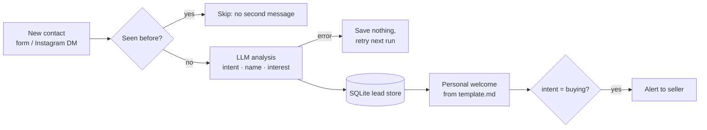

# Welcome & Lead-Capture Agent

**English** · [فارسی](README.fa.md)

[](https://github.com/nazaninpnhi89-oss/welcome-lead-capture-agent/actions/workflows/tests.yml)

An AI agent that answers every new contact (website form or Instagram DM) within seconds: it reads the message, works out what the person wants, saves them as a lead, sends a personal welcome, and pings the sales team when someone is ready to buy.

Built for small businesses that lose leads because nobody replies in time. The primary market is Persian-speaking, so the code comments and default message template are in Persian; the pipeline itself is language-aware and handles English messages too.

**[Live demo (English sample run) →](https://nazaninpnhi89-oss.github.io/welcome-lead-capture-agent/)**

## How it works



1. **Analysis.** An LLM classifies intent (`buying` / `question` / `other`) and extracts the person's name and what they're interested in. With Claude it uses structured outputs, so the reply always matches a JSON schema.
2. **Welcome.** The message is filled in from `template.md`, one section per intent, which a non-technical owner can edit. The webhook server re-reads it on every message, so no restart is needed.
3. **Hand-off.** Buying-intent leads are written to `alerts.log` with a one-line summary for the seller.

## Engineering decisions

- **One message per person, guaranteed.** Contacts are identified by Instagram ID, then normalised email, then normalised phone number (`0912…`, `+98 912…` and Persian digits all count as the same number). The check runs *before* the LLM call, so duplicates cost nothing, and a `UNIQUE` constraint in the database is a second layer. The lead is saved before the message is sent, so a crash mid-send can never cause a double message.
- **A failed analysis never produces a wrong message.** If the model call fails for one contact, nothing is saved or sent and the next run retries it. Account-level errors (invalid key, no credit) stop the whole run immediately instead of failing 500 times.
- **Prompt-injection aware.** The prompt treats the contact's message as data, not instructions.
- **Swappable model.** `LLM_PROVIDER=claude | ollama | mock`. Ollama runs a free local model (default `qwen3:8b`), and `mock` is a keyword classifier for offline testing and CI.
- **Secure webhook.** The Instagram endpoint checks Meta's `X-Hub-Signature-256` HMAC, ignores echoes of its own replies (which would otherwise cause an infinite loop), acknowledges Meta right away and processes messages on a background queue.
- **Few dependencies.** Standard library plus the `anthropic` SDK. There is no web framework.

## Project status

| Part | Status |
|---|---|
| Analysis → lead store → welcome → seller alert | ✅ Working (Claude, local Ollama, mock) |
| Duplicate protection, error handling, logging | ✅ Working, covered by tests |
| Instagram webhook server + DM sending | 🧪 Built and tested with simulated Meta payloads; not yet connected to a live account |
| Real email / Telegram / WhatsApp delivery | 📋 Planned: replies currently go to `outbox/` |
| Seller alerts to Telegram / Slack | 📋 Planned: currently a log file |

## Quick start

```bash
python3 -m venv .venv
.venv/bin/pip install -r requirements.txt
cp .env.example .env                                   # add ANTHROPIC_API_KEY, or use Ollama / mock

.venv/bin/python -m welcome_automation.run --mock      # offline, no API key needed
.venv/bin/python -m welcome_automation.run             # real analysis with the provider in .env
.venv/bin/python -m welcome_automation.run --dry-run   # print only, write nothing
.venv/bin/python -m welcome_automation.webhook_server  # Instagram webhook on :8000
```

`new_contacts.json` holds 6 sample contacts: two buyers, one curious visitor, one question, one vague "hi", and one duplicate.

## Tests

```bash
.venv/bin/python -m unittest discover -s tests -v
```

The tests run offline. They cover phone/email normalisation, duplicate protection across runs, the "failed analysis saves nothing" rule, template rendering, webhook signature checks and echo filtering.

## Layout

```
welcome_automation/
  run.py             entry point; process_contact() is source-agnostic
  analyzer.py        Claude / Ollama / mock analysers
  storage.py         SQLite lead store + duplicate key
  messenger.py       template rendering + sending
  alerts.py          seller notification
  instagram.py       Instagram API, signature check, payload parsing
  webhook_server.py  Meta webhook server with background worker
template.md          editable welcome messages
showcase/            generator for the demo page (Persian + English)
tests/               offline unit tests
```

---
Built by **SYNIQ AI**.
